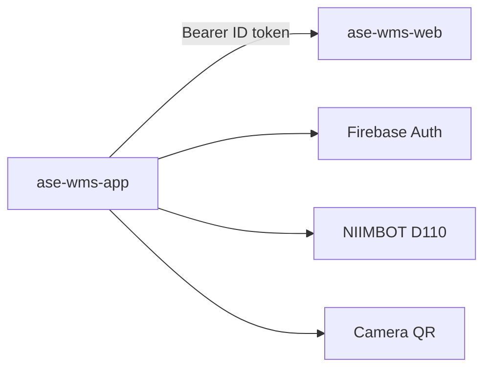
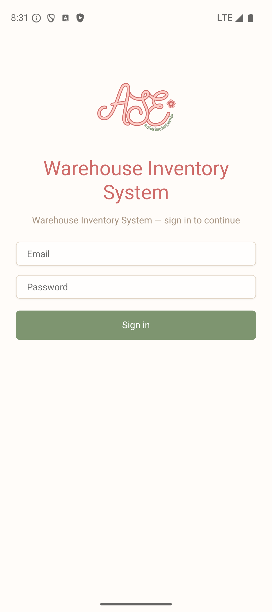
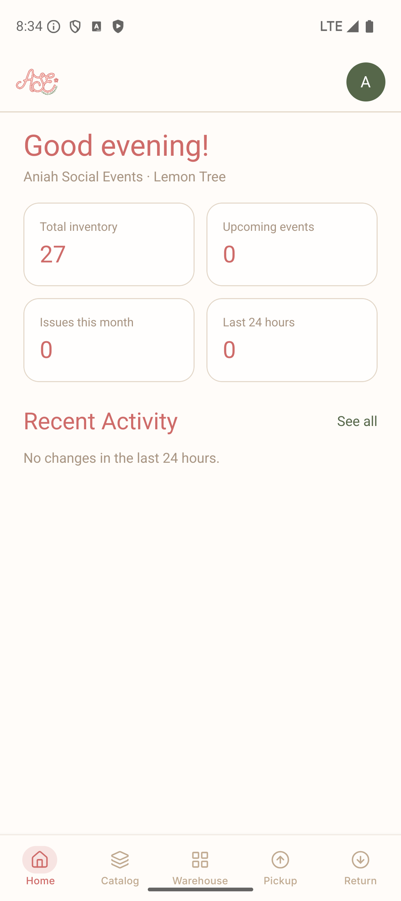
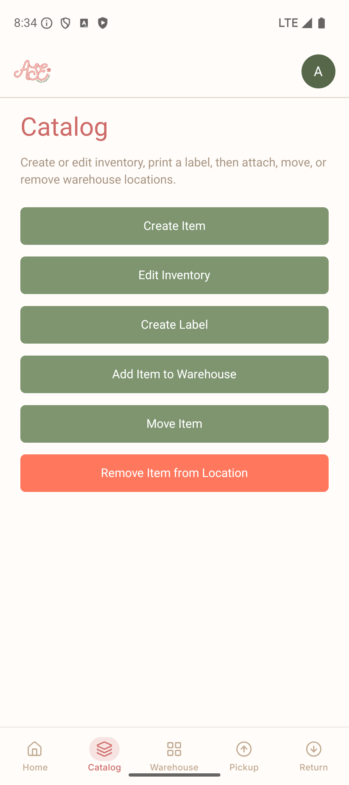
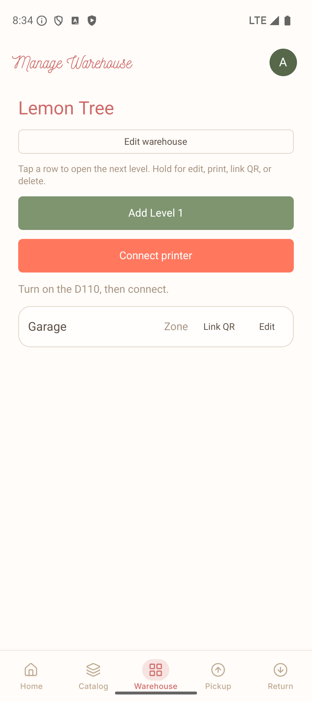
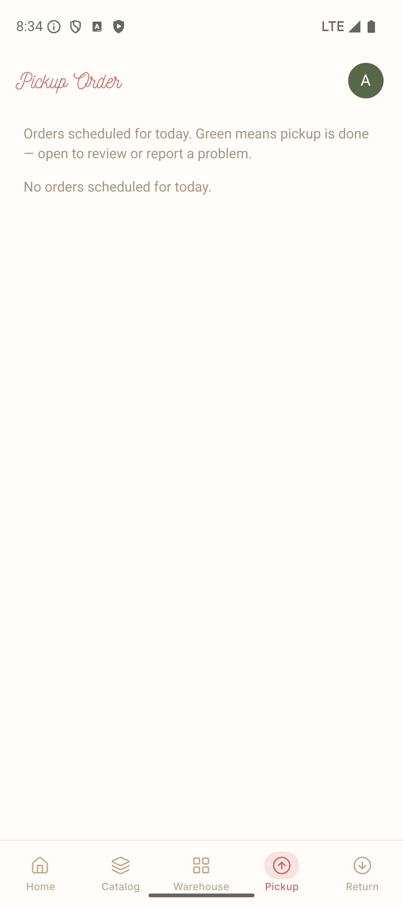

# ASE WIS — Mobile app

Expo (SDK 57) warehouse app for Aniah Social Events. Floor companion to [`ase-wms-web`](https://github.com/agustindevelops/ase-wms-web). Display name **WIS**.

Staff catalog rental inventory, print QR labels on a NIIMBOT D110, place items in the warehouse tree, and pick up or return today’s event orders. This repo has no database. Every read and write goes to the Next.js API in `ase-wms-web`.

Orders on the Pickup tab were created when a guest booked on [`aniah-social-events`](https://github.com/agustindevelops/aniah-social-events). The phone never calls that site.

| Piece | Repo | Role |
| --- | --- | --- |
| Customer site | [`aniah-social-events`](https://github.com/agustindevelops/aniah-social-events) | Guest booking at [aniahsocialevents.com](https://www.aniahsocialevents.com) |
| WIS admin + API | [`ase-wms-web`](https://github.com/agustindevelops/ase-wms-web) | System of record |
| WIS phone app | [`ase-wms-app`](https://github.com/agustindevelops/ase-wms-app) (this project) | Scan, print, pick, return |



UI: [gluestack-ui](https://gluestack.io/) v5 with **UniWind** (Tailwind CSS v4).

## Tour

Five tabs after sign-in: **Home**, **Catalog**, **Warehouse**, **Pickup**, **Return**.

### Sign in



Email and password `POST` to `{EXPO_PUBLIC_ASE_WIS_API_URL}/login` on `ase-wms-web`. The API returns a Firebase custom token; the app calls `signInWithCustomToken`. Same Firebase project as the admin. Later requests send `Authorization: Bearer <idToken>`.

### Home



`GET /api/me` then dashboard summary and activity. Org and warehouse (seeded **Lemon Tree**) sit under the greeting.

### Catalog



Photograph a new item, set name / qty / category / material, print a QR, stick it on the piece, then scan a location QR to place it. Edit, relabel, move, and remove are the same menu.

### Warehouse



Build the location tree (zone, aisle, rack, shelf), print or link location labels, and connect the D110. Peach **Connect printer** is the not-yet-connected state.

### Pickup



Today’s event orders (`America/Chicago`). Scan item QRs and record quantities. **Return** is the same list after pickup, plus a shelf scan when items go back.

## How it connects

| Env | Points at |
| --- | --- |
| `EXPO_PUBLIC_ASE_WIS_API_URL` | `ase-wms-web` including `/api`, no trailing slash. Emulator example: `http://10.0.2.2:3000/api` |
| `EXPO_PUBLIC_FIREBASE_*` | Same Firebase project as `ase-wms-web` |

Axios client: `src/api/client.ts`. Feature calls live in `src/api/*.ts` (catalog, warehouse, order, issue, images). Photos: `POST /img/upload` returns a presigned URL, the device `PUT`s bytes, then `POST /img/verify`.

QR payloads: type `0` is an item, type `1` is a location — same constants as `ase-wms-web`.

Printer: Bluetooth LE, JADENS / NIIMBOT D110 (`react-native-niimblue-lib`). BLE does not work in Expo Go; use a development build.

## Structure

```
App.tsx                         # GluestackUIProvider + RootNavigator
src/
  api/                          # axios client + feature endpoints
  auth/                         # session flag + MeSession
  firebase/                     # SDK init + signIn/signOut
  navigation/                   # session gate + MainTabs
  features/
    auth/                       # login
    dashboard/                  # Home
    catalog/                    # create / edit / label / place
    manageWarehouse/            # location tree + print
    order/                      # pickup + return
    print/                      # D110
    scan/                       # camera QR
    reportIssue/                # missing / broken
```

Feature paradigm: **dumb `ui/`**, **handlers in `hook/`**, **`index` container** wires them.

## Requirements

- Node 20+
- Android device or emulator with USB debugging
- Expo development build (BLE will not work in Expo Go)
- Running `ase-wms-web` (`npm run dev` on port 3000) for login and every screen

## Config

```bash
cp .env.example .env
# EXPO_PUBLIC_ASE_WIS_API_URL=http://10.0.2.2:3000/api
# plus EXPO_PUBLIC_FIREBASE_* from the same project as ase-wms-web
```

## Run on Android

Native modules (gesture-handler, reanimated, svg, BLE) require a rebuild after install:

```bash
npm install
npm run android
```

Later sessions:

```bash
npm run start:dev-client
```

Also: `npm run ios`, `npm run web`. Production Android builds use `.env.prod` via `npm run build`.

## Add more gluestack components

```bash
npx gluestack-ui@latest add alert -y
```

Components land in `src/components/ui/`.
